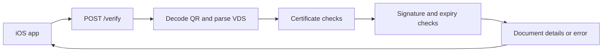

<p align="center">
  
</p>

<h1 align="center">miDNI-backend</h1>

<p align="center">
  A Node.js proof of concept for verifying Spain's DNIe data shared through miDNI QR codes.
</p>

<p align="center">
  
  
  
  <a href="LICENSE"></a>
</p>

<p align="center">
  <a href="#getting-started">Getting started</a> ·
  <a href="https://github.com/artcc/miDNI-qr">iOS app</a> ·
  <a href="documentation/MiDNI-FormatoQR_v107_sc_PN.pdf">QR specification</a> ·
  <a href="CHANGELOG.md">Changelog</a>
</p>

## About the POC

**miDNI-backend is the backend proof of concept (POC) for verifying Spain's electronic identity document (DNIe) data**, shared through QR codes generated by the official **miDNI** app from Policía Nacional.

The API receives binary QR data, decodes its contents, checks the signing certificate, signature, and data expiry, and returns document fields and a photo or a verification error. Certificate chain and OCSP checks depend on the configured CA, as described in [Certificates and OCSP](#certificates-and-ocsp).

The complete POC consists of two repositories:

| Component | Repository | Responsibility |
| --- | --- | --- |
| iOS app | [artcc/miDNI-qr](https://github.com/artcc/miDNI-qr) | Camera capture, QR scanning, API requests, and result display |
| Backend | This repository | QR decoding, verification, and document data returned to the app |

## Features

- **Binary QR input** accepting iOS error-corrected codewords or an already decoded VDS payload.
- **VDS parsing** for the header, TLV fields, and signature.
- **ECDSA SHA-256 verification** and QR data expiry checks.
- **Certificate lookup** by serial number, with configurable CA, intermediates, and OCSP.
- **Age, simple, and complete profile fields** returned through a shared response structure.
- **Bearer authentication**, IP-based rate limiting, and Helmet security headers.
- **Message-only application logs** without request data, QR contents, or error details.

## How it works



1. The iOS app sends `CIQRCodeDescriptor.errorCorrectedPayload` unchanged as a JSON byte array.
2. The backend checks the bearer token and validates the input array.
3. `qrDecoder.js` decodes QR codewords; VDS bytes starting with `0xDC` are passed to the parser directly.
4. `qrParser.js` extracts the header, document fields, signed byte range, and signature.
5. `verifySignature.js` coordinates certificate lookup, certificate checks, signature verification, and data expiry validation.
6. The API returns document data when verification succeeds, or a `reason` code otherwise.

## Requirements

- **Node.js 24 LTS recommended for development**, with npm. The application declares Node.js >= 18 in `package.json`, but the included ESLint 10 tooling needs a newer runtime.
- Network access to the certificate repository and, when CA validation is enabled, the OCSP service.
- A bearer token configured for the API.
- A running [miDNI-qr iOS app](https://github.com/artcc/miDNI-qr) for the end-to-end camera flow.

## Getting started

### 1. Install and configure

```bash
git clone https://github.com/artcc/miDNI-backend.git
cd miDNI-backend
npm install
cp .env.example .env
```

Edit `.env` and replace `BEARER_TOKEN` with a long, random value. Configure the CA and any intermediates to enable chain validation and OCSP.

### 2. Start the backend

Using the recommended Node.js version, load `.env` explicitly and start in watch mode:

```bash
node --env-file=.env --watch src/server.js
```

The API listens on port `3000` by default. Its liveness endpoint is available at `http://localhost:3000/health`.

The npm scripts do **not** load `.env` automatically. When variables are already exported in your shell or supplied by your hosting environment, use:

```bash
npm run dev
```

For a regular process without watch mode, use `npm start`. Set `NODE_ENV=production` for JSON logs without the development pretty-print transport.

### 3. Connect the iOS app

Follow the setup instructions in **[artcc/miDNI-qr](https://github.com/artcc/miDNI-qr)** and configure its `BackendConfig.swift`:

| Setting | Value |
| --- | --- |
| `baseURLString` | Your reachable API base URL, without a trailing slash or `/verify` |
| `bearerToken` | The same value as `BEARER_TOKEN`, without the `Bearer ` prefix |

Use a backend URL reachable from the physical iPhone; `localhost` on the phone refers to the phone itself. The app appends `/verify` and adds the authentication header automatically.

## Configuration

Environment variables are documented in [`.env.example`](.env.example).

| Variable | Default | Purpose |
| --- | --- | --- |
| `PORT` | `3000` | HTTP listening port |
| `BEARER_TOKEN` | None | Required token for protected routes |
| `MAX_PAYLOAD_BYTES` | `65536` | Maximum number of bytes in `payloadBytes` |
| `RATE_LIMIT_RPM` | `30` | Requests per minute per IP, using an in-memory limiter |
| `LOG_LEVEL` | `info` | `trace`, `debug`, `info`, `warn`, `error`, `fatal`, or `silent` |
| `NODE_ENV` | Unset | `production` disables pretty-print logging |
| `INCLUDE_THUMBNAIL_BASE64` | `true` | Include the JPEG2000 photo as Base64; set to `false` to return `null` |
| `CERT_BASE_URL` | `http://pki.policia.es/cnp/MiDNI` | Certificate repository |
| `CERT_FILE` | `APPDNIMOVIL.cer` | First certificate filename attempted |
| `CA_CERT_PATH` / `CA_CERT_PEM` | None | CA certificate as a PEM file or inline PEM text |
| `INTERMEDIATE_CERTS_PATH` / `INTERMEDIATE_CERTS_PEM` | None | Intermediate certificates as a PEM bundle |
| `OCSP_URL` | `http://ocsp.policia.es` | OCSP responder |

The HTTP JSON body limit is `1mb`, independent of `MAX_PAYLOAD_BYTES`. Inline PEM values take precedence over the corresponding file paths.

## API contract

### GET /health

Public liveness endpoint, excluded from the rate limiter and automatic HTTP logs:

```json
{
  "status": "ok"
}
```

This endpoint reports that the server is running; it does not check certificate configuration or external services.

### POST /verify

```http
POST /verify
Content-Type: application/json
Authorization: Bearer <token>
```

Example request body, with illustrative bytes rather than a valid QR:

```json
{
  "payloadBytes": [1, 2, 3]
}
```

`payloadBytes` must be a non-empty array of integers from `0` to `255`, within the configured size limit. It accepts:

- **Raw QR codewords** from iOS `errorCorrectedPayload`, decoded by the backend.
- **VDS payload bytes** beginning with `0xDC 0x03`, parsed directly.

### Successful response

The API returns **HTTP 200** with `valid: true`. Illustrative response excerpt with fictitious values:

```json
{
  "valid": true,
  "documentNumber": "12345678Z",
  "givenName": "NOMBRE",
  "surnames": "APELLIDOS",
  "birthDate": "01-01-1990",
  "isAdult": true,
  "dataExpiry": "01-01-2030 12:34:56"
}
```

Successful responses use the same structure for every QR profile. Missing scalar values are generally `null`, and missing address or birthplace lines are empty arrays.

| Fields | Purpose |
| --- | --- |
| `valid` | Verification result |
| `documentNumber`, `givenName`, `surnames` | Identity fields |
| `birthDate`, `sex`, `nationality` | Personal details |
| `documentExpiry`, `supportNumber`, `parents` | Additional document fields |
| `isAdult` | Boolean from tag `0x70`, or derived from the birth date when that tag is absent; `null` when it cannot be resolved |
| `dataExpiry` | QR data expiry in `DD-MM-YYYY HH:mm:ss`, interpreted in UTC |
| `addressFull`, `addressLines` | Full address and an array of address lines |
| `placeOfBirthLines` | Array of birthplace lines |
| `thumbnailBase64` | Base64-encoded JPEG2000 photo, or `null` when absent or disabled |
| `rawFields` | Recognized TLV fields keyed by tag, header metadata, and data expiry |

Date-only document fields use `DD-MM-YYYY`. The birth-date fallback for `isAdult` calculates whether the person has reached 18 years of age in UTC.

### Error response

Verification and handled request errors use this structure:

```json
{
  "valid": false,
  "reason": "SIGNATURE_INVALID"
}
```

| HTTP status | Reason | Meaning |
| --- | --- | --- |
| `400` | `STRUCTURE_INVALID` | Invalid byte array or QR structure |
| `400` | `CERT_INVALID` | Certificate lookup, validity, chain, or OCSP check failed |
| `400` | `SIGNATURE_INVALID` | Signature conversion or verification failed |
| `400` | `QR_EXPIRED` | QR data expiry is missing, incorrectly formatted, or in the past |
| `400` | `INVALID_JSON` | Malformed JSON body |
| `401` | `AUTH_MISSING_BEARER` | Missing or incorrectly formatted bearer header |
| `403` | `AUTH_INVALID_BEARER` | Token does not match the configured value |
| `429` | `RATE_LIMITED` | Request limit exceeded |
| `500` | `SERVER_NOT_CONFIGURED` | `BEARER_TOKEN` is not configured |
| `500` | `INTERNAL_ERROR` | Unexpected error or an unhandled body-parser error |

## Certificates and OCSP

The included specification publishes these CNP endpoints:

- **Certificate repository:** http://pki.policia.es/cnp/MiDNI
- **OCSP responder:** http://ocsp.policia.es

The backend searches for a certificate whose serial number matches the reference in the QR header, starting with `CERT_FILE` and then the repository index. The PDF examples use a test certificate rather than the default signing certificate; see the specification for their references and expected results.

Configure `CA_CERT_PATH` or `CA_CERT_PEM` to enable certificate chain validation and OCSP. If the signing certificate requires intermediates, supply them through `INTERMEDIATE_CERTS_PATH` or `INTERMEDIATE_CERTS_PEM`.

**Current POC behavior:** when no CA certificate is loaded, chain validation and OCSP are skipped. Certificate validity dates, the QR signature, and data expiry are still checked. A successful response in this configuration does not mean that the certificate chain or revocation status was verified.

## Project structure

```text
miDNI-backend/
├── src/
│   ├── server.js
│   ├── logger.js
│   ├── middleware/
│   │   └── auth.js
│   ├── routes/
│   │   └── verify.js
│   └── services/
│       ├── qrDecoder.js
│       ├── qrParser.js
│       ├── verifySignature.js
│       ├── certProvider.js
│       ├── trust.js
│       └── ocsp.js
├── assets/
├── documentation/
│   └── MiDNI-FormatoQR_v107_sc_PN.pdf
├── .env.example
├── eslint.config.mjs
└── package.json
```

## Data flow and logging

QR bytes are processed in memory and document fields are returned in the HTTP response after verification succeeds. The backend has no database or document storage. Certificate downloads and OCSP checks make outbound requests to the configured services.

Application logs contain only a timestamp, severity, and a fixed event message at every log level. Structured arguments and formatting parameters are discarded; HTTP request/response context, tokens, QR data, certificate details, and error details are excluded. When adding log calls, use fixed strings and never interpolate data into the message.

## Development

| Command | Purpose |
| --- | --- |
| `npm run dev` | Start with Node.js watch mode; environment variables must already be supplied |
| `npm start` | Start without watch mode; environment variables must already be supplied |
| `npm run lint` | Run ESLint |
| `npm run lint:fix` | Run ESLint and apply automatic fixes |

The repository currently has no automated test suite. The included specification provides sample QR codes for manual verification scenarios.

## Documentation and contributing

- [QR format and verification specification](documentation/MiDNI-FormatoQR_v107_sc_PN.pdf) — includes sample QR codes for valid, expired, and modified data scenarios.
- [Changelog](CHANGELOG.md) — version history.
- [Contributing](CONTRIBUTING.md) — development guidelines.
- [iOS app POC](https://github.com/artcc/miDNI-qr) — the companion project for end-to-end scanning and result display.

## License

Distributed under the **MIT License**. See [LICENSE](LICENSE).

## Author

[Arturo Carretero Calvo](https://github.com/artcc)
